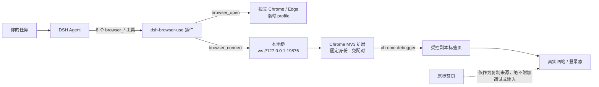

<div align="center">


<h1>DSH Browser Control</h1>

<p><strong>把 AI 接进你真实的浏览器。</strong></p>

<p>接管已登录的 Chrome / Edge 标签页，在后台副本中观察、点击、填表、编辑配置、操作 Web 终端。<br>
原页面保持原样，不抢焦点，不新开自动化窗口。</p>

<p>
  
  
  
  
  
</p>

<p>
  <a href="#快速开始">快速开始</a> ·
  <a href="#核心能力">核心能力</a> ·
  <a href="#工具">工具</a> ·
  <a href="#安全模型">安全模型</a> ·
  <a href="#文档">文档</a>
</p>

</div>

> **通用浏览器接管，不止堡垒机。** 插件不绑定 JumpServer、Nacos 或任何特定网站；已登录的运营后台、SaaS、表单与审批、Nacos / Kubernetes 配置、网页代码编辑器和 Web SSH，都可以交给 Agent 在你的真实浏览器里完成。

DSH Browser Control（包名 `dsh-browser-use`）是一个 **DeepSeek Harness（DSH）服务端插件**，配套 **Chrome MV3 扩展**。安装后，Agent 获得 8 个 `browser_*` 工具，可以观察页面、引用元素、截图、点击、输入、管理标签页、结构化编辑配置，并操作网页终端。

它和常见的自动化脚本最大的区别是：**默认不启动一个全新浏览器、也不要求重新登录**。插件会按网址 / 标题找到你已经打开的页面，在同一个窗口后台创建一个带标记的副本，然后只控制副本。原标签页不会被附加调试器、不会被输入、也不会被关闭。

当前版本 **0.5.1**，验证环境为 **DSH 0.2.2-rc.1**、**Node.js ≥ 24.9.0**、**Chrome / Edge 125+**。无需配对令牌，无需 MCP 服务，也无需开启浏览器远程调试端口。

## 核心能力

- **接管真实登录态**：复用当前 Chrome / Edge profile 的 Cookie、localStorage 和网站登录，不需要在新浏览器里重新登录或重复过验证码。
- **原页面零打扰**：在源页面所在窗口以 `active:false` 创建唯一副本，不新开窗口、不移动标签页、不切换活动标签页；副本显示 `【被接管】` 标题、`DSH · 被接管` 标签组和页面角标。
- **完整的浏览器操作**：DOM 元素引用、Playwright selector、截图、坐标、键盘、滚动、拖拽、下拉框、多标签页、iframe 和开放的 Shadow DOM。
- **为 Agent 设计的观察协议**：每次动作返回新的页面快照；元素引用与真实元素绑定，页面变化后旧引用会报错，避免误点。
- **结构化编辑，不是盲插文本**：自动识别 Monaco / Ace / CodeMirror / textarea 与 YAML / JSON / properties / XML / SQL / JavaScript，按路径修改并保持缩进、换行、注释和层级；先预览校验，再写入编辑器草稿。
- **网页终端**：识别 JumpServer / xterm 终端，文字与 Enter 分开发送，读取可访问的 DOM 输出；Canvas / WebGL 场景可回退截图。
- **多会话隔离**：一个源标签页只保留一个副本，同一时间只属于一个 DSH 会话；完成、取消或超时后释放控制，网页仍然保留。
- **本地安全边界**：桥只监听 `127.0.0.1`，校验固定扩展的 Origin 与身份握手；不开放公网 CDP，不提供任意 JavaScript 执行。

## 适用场景

| 场景 | 你可以这样说 |
| --- | --- |
| 已登录后台 | “接管我当前的运营后台，把这条工单改成已处理，提交前先给我看。” |
| 表单与审批 | “照着这份资料填写页面表单，不确定的字段先问我。” |
| 配置中心 | “在 Nacos 的 `env` 下新增 `NEW_OPTION`，先预览 YAML 改动，不要发布。” |
| 研发测试 | “复现这个页面的 iframe / Shadow DOM 问题，并截图给我。” |
| Web SSH 运维 | “接管 JumpServer 页面，执行 `kubectl get pods -n prod`，把输出发给我。” |
| 信息核对 | “对比这两个标签页的价格和库存，整理成表格。” |

## 两种工作模式

| | 接管已有 Chrome / Edge | 启动独立浏览器 |
| --- | --- | --- |
| 适合 | 已登录系统、SSO / 验证码后的真实工作现场 | 从零开始的一次性任务，或希望与个人浏览器隔离 |
| 启动方式 | 加载扩展，扩展自动连接本机 DSH | `browser_open` |
| 浏览器身份 | 复用当前 profile 与登录态 | 临时 profile，关闭或闲置 15 分钟后清理 |
| 页面范围 | 只控制带标记的副本，源页面不动 | 插件自己拥有的浏览器窗口 |
| 需要扩展 | 是 | 否 |

两种模式都不需要 MCP，也不需要额外启动一个浏览器控制服务。

## 工作原理



接管过程只有四步：

1. **匹配**：按网址、标题或关键词找到源标签页；没有唯一结果时返回候选，不猜测。
2. **复制或复用**：同一个源标签页只创建一个后台副本；重复接管、重连和换会话会复用它。
3. **标记**：给副本加标题前缀、统一接管标签组和页面角标。
4. **控制**：只把调试器和输入发往副本；多个源页面复用同一个接管标签组，操作顺序执行。

## 快速开始

### 环境要求

| 组件 | 要求 |
| --- | --- |
| DSH | `0.2.2-rc.1`（当前验证版本） |
| Node.js | `>= 24.9.0` |
| pnpm | 11+；DSH 插件管理通过它安装组合包，缺失时按 DSH 提示安装 |
| 浏览器 | Chrome / Edge 125+；也支持指定本机 Chromium 路径 |
| 操作系统 | Windows 为主要验证环境；macOS / Linux 可指定浏览器路径，欢迎反馈兼容性 |

### 1. 安装 DSH 插件

从源码安装（推荐）：

```powershell
git clone https://github.com/vibecoder-lbz/DSH-Browser-Control.git
cd DSH-Browser-Control
npm install --ignore-scripts
dsh plugin --profile web add .
```

把 `web` 换成你实际使用的 DSH profile。如果 DSH 提示需要重启，请重启原来的 DSH 进程；插件是服务端工具，不需要另起 Web 服务。若提示找不到 pnpm，可先执行 `npm install --global pnpm@11 --ignore-scripts`，重新打开终端后再安装。

也可以先打包，再安装 `.tgz`：

```powershell
npm run pack:plugin
dsh plugin --profile web add .\dsh-browser-use-0.5.1.tgz
```

如果已安装旧版组合包，先用 `dsh plugin --profile web remove dsh-browser-use` 移除，再添加新版。项目目前**没有发布到 npm 公共注册表**，请使用源码或本地安装包。

### 2. 加载 Chrome 扩展

1. 打开 `chrome://extensions`，启用“开发者模式”。
2. 选择“加载已解压的扩展程序”，指向本仓库的 `chrome-extension` 目录。
3. 在工具栏固定扩展；弹窗中可以看到连接状态，并可以暂停 / 恢复自动连接。

建议先把 `chrome-extension` 复制到一个固定目录再加载，避免移动或删除仓库后扩展失效。Edge 用户可以在 `edge://extensions` 中加载同一目录。

扩展会自动连接 `ws://127.0.0.1:19876/extension`，**没有配对码**。只有修改了 `bridgePort` 时，才需要在扩展高级设置中填写相同的地址。扩展只负责连接浏览器，实际工具由正在运行的 DSH 插件提供；只安装扩展不会凭空获得 AI 控制能力。

### 3. 验证连接

```jsonc
browser_connect({ "action": "status" })
```

返回 `{"connected":true}` 即表示桥接正常。扩展与 DSH 的启动顺序不限，扩展会自动重连；也可以在对话里直接说“检查浏览器扩展连接状态”。

### 4. 开始第一个任务

安装完成后，直接用自然语言描述目标：

> 复制并接管当前 Chrome 里已经登录的后台，先告诉我页面上有哪些可操作项。

> 打开浏览器访问 https://example.com，截图并总结页面内容。

> 接管 Nacos 配置页，在 `env` 下新增 `NEW_OPTION`，先展示 YAML 预览，不要发布。

## 接管已有页面：复制，而不是劫持

接管时，插件不会把调试器附加到你的原标签页，也不会把点击或键盘输入发到原页面。它按源页面的网址 / 标题匹配目标，在源窗口后台打开同网址副本，之后所有操作只作用于副本。

```jsonc
// 查看可接管的用户标签页
browser_connect({ "action": "list" })

// 按网址 / 标题 / 关键词匹配，自动创建或复用副本
browser_connect({ "action": "select", "query": "Nacos", "screenshot": true })

// 已知标签页 ID 时可以直接指定，避免同名歧义
browser_connect({ "action": "select", "tabId": "chrome-123" })
```

几个重要保证：

- **唯一副本**：同一个源标签页全局只保留一个控制副本；副本被其他会话占用时返回错误，不会悄悄再复制一份。
- **同一标签组**：接管多个不同页面时，副本都放入同一个 `DSH · 被接管` 标签组，不会每接管一次就新建一组。
- **不抢焦点**：不激活标签页、不置前窗口、不切换活动标签页。你可以继续使用原页面，Agent 在后台副本中工作。
- **源页面只读**：原标签页不能被附加调试、输入或通过本插件关闭；只有副本可以被释放控制或显式关闭。
- **释放后保留网页**：取消、超时、断开连接和插件卸载只释放副本控制并移除标记，原页面和副本都不删除。

副本复用当前浏览器 profile，因此与原页面**共享 Cookie、localStorage 和网站登录**。它复制的是同网址页面，不是页面运行内存：未提交表单、导航历史、正在运行的 JavaScript、WebSocket 或现有 SSH 会话不会迁移。在副本中提交表单或退出登录，仍会影响同一个后台系统和同一个账号。

## 工具

| 工具 | 功能 |
| --- | --- |
| `browser_connect` | 连接扩展；`status` / `list` / `select` / `disconnect`；按 `query` 或 `tabId` 复制并接管页面 |
| `browser_open` | 启动独立浏览器、导航到网址，可选新标签页与截图 |
| `browser_observe` | 重新观察页面，返回网址、标题、各 frame 文本、可见交互元素和标签页列表 |
| `browser_act` | 点击、双击、悬停、填入、输入、按键、滚动、拖拽、选择下拉项、前进、后退、刷新、等待 |
| `browser_tabs` | 列出、新建、切换、关闭标签页；原标签页不可关闭 |
| `browser_terminal` | 发现 iframe 内的 xterm / Web SSH，逐行输入、单独回车、读取输出、等待结果与截图 |
| `browser_editor` | 识别编辑器与文档格式，读取、预览、校验并应用结构化编辑，不自动发布 |
| `browser_close` | 已有 Chrome 模式仅释放控制；独立模式关闭浏览器并清理临时 profile |

每次 `browser_observe` 或 `browser_act` 都会返回一份新的观察结果。可交互元素带有 `s3e2` 一类的引用 ID，引用与当时的真实元素绑定，下一次观察后更新；过期引用会报错，防止页面改变后误点。

```jsonc
// 使用最近一次观察返回的 ref 操作；具体 ID 以实际结果为准
browser_act({ "action": "click", "ref": "s1e3" })

// 也可以使用唯一的 Playwright selector
browser_act({ "action": "fill", "selector": "input[name='email']", "text": "hello@example.com" })
browser_act({ "action": "press", "key": "ControlOrMeta+A" })

// 坐标基于浏览器可视区域左上角，单位为 CSS 像素
browser_act({ "action": "click", "x": 420, "y": 280 })
browser_act({ "action": "scroll", "deltaY": 600 })
browser_act({ "action": "drag", "x": 100, "y": 200, "toX": 400, "toY": 200 })
```

`ref`、`selector` 与 `x/y` 三种目标只能选择一种。`fill` 替换输入框内容，`type` 在光标处插入文字，`press` 用于 Enter、Tab 和组合键。iframe 与开放的 Shadow DOM 可以通过元素引用操作。

截图默认关闭，开启时只截取可视区域，并通过 DSH 附件服务传给支持图片输入的模型；纯文本模型仍可使用 DOM 快照，收到的是文字说明和元素列表。某些 Chrome 不会绘制被遮挡的后台页面，这时截图会返回明确的不可用提示，插件不会为了截图而切换标签页。

## 结构化编辑：识别场景，而不是硬编码

`browser_editor` 不会假定当前页面是 Nacos，也不会把文字直接拼到光标处。它先识别两件事：

1. **编辑器实现**：Monaco、Ace、CodeMirror 5 或普通 textarea，包括 iframe 内的编辑器。
2. **文档格式**：根据编辑器语言标签和实际内容判断 YAML、JSON、properties、XML、SQL、JavaScript 或普通文本；两者冲突时以内容为准，避免把 JSON 当 YAML 重排。

随后，工具读取编辑器的真实文档、版本标识、缩进、换行符、注释、引号和 YAML 锚点，再选择对应操作：

| 格式 | 结构化操作 |
| --- | --- |
| YAML | `yaml_set`、`yaml_delete`、`replace` |
| JSON | `json_set`、`json_delete`、`replace` |
| properties / INI | `properties_set`、`properties_delete`、`replace` |
| XML / HTML / SQL / JavaScript / text | `replace`（唯一片段替换） |

结构化操作按路径定位父节点，新增字段与同级字段对齐，而不是固定插入几行空格。原始文档使用 4 空格缩进就继续使用 4 空格；LF / CRLF 保持原样；常见注释和引号会保留。修改 YAML 锚点且可能影响其他别名引用时，操作会被拒绝，避免改一个字段却改变另一个位置。

例如在：

```yaml
server:
  port: 8080
env:
  EXISTING: "keep this"
```

对路径 `["env", "NEW_OPTION"]` 执行 `yaml_set`，会得到：

```yaml
server:
  port: 8080
env:
  EXISTING: "keep this"
  NEW_OPTION: new-value
```

新字段位于 `env` 下，与 `EXISTING` 同级。Nacos 只是常见页面之一，同样的流程适用于任何 Monaco / Ace / CodeMirror / textarea 中的 YAML、JSON 或 properties 文档。

编辑流程是**先读、再预览、后应用**：

```jsonc
// 1. 读取文档与 revision
browser_editor({ "action": "read", "editorId": "editor1" })

// 2. 按路径预览改动；revision、文档对象或页面 URL 变化都会让计划失效
browser_editor({
  "action": "preview",
  "editorId": "editor1",
  "expectedRevision": "<read 返回的 revision>",
  "operation": "yaml_set",
  "path": "[\"env\",\"NEW_OPTION\"]",
  "valueJson": "\"new-value\""
})

// 3. 应用 preview 返回的 planId，并回读校验
browser_editor({ "action": "apply", "editorId": "editor1", "planId": "<preview 返回的 planId>" })
```

工具**不会自动点击发布、保存或提交按钮**。是否发布由你或 Agent 在确认预览内容后按页面流程决定。详细示例见 [结构化编辑说明](./docs/structured-editing.md)。

## Web 终端

JumpServer 是网页终端的一个常见入口，但不是插件的边界。任何使用 xterm.js 的 Web SSH 页面都可以尝试识别。命令文字与 Enter 分开发送：

```jsonc
browser_terminal({ "action": "list", "screenshot": true })
browser_terminal({ "action": "type", "terminalId": "terminal1", "text": "kubectl get pods -n prod" })
browser_terminal({ "action": "press", "terminalId": "terminal1", "key": "Enter" })
browser_terminal({ "action": "wait", "terminalId": "terminal1", "timeoutMs": 3000 })
```

输出优先读取 xterm 的无障碍 DOM 或可访问渲染行；Canvas / WebGL 没有可读文本时返回 `textReadable=false`，需要支持图片输入的模型查看截图。输入派发成功不等于远端命令执行成功，断连也不等于回滚已经提交的操作。完整流程见 [JumpServer / Kubernetes 指南](./docs/jumpserver-kubernetes.md)。

## 安全模型

这是一个**本地浏览器控制工具**，设计目标是尽量不打扰你现有的浏览器，并把控制面留在本机。

- **只控制副本**：源标签页只作为复制来源，不附加 `chrome.debugger`，不接收输入，也不会被本插件关闭。
- **不抢焦点**：不激活标签页、不置前窗口、不切换活动标签页；后台页面无法绘制截图时明确告知，而不是切到前台获取画面。
- **本地桥**：只绑定 `127.0.0.1`，严格校验 Host、固定扩展的 `chrome-extension://` Origin 和 v2 身份握手。**没有配对码不等于开放端口**，普通网页和其他扩展无法直接接入。
- **不执行任意 JavaScript**：导航只接受 HTTP(S) URL，没有提供“在页面里运行任意脚本”的工具。
- **不自动发布**：编辑器只写入草稿并回读校验；表单提交、发送、购买、部署等外部操作仍由你的指令和页面流程决定。
- **页面内容是不受信任数据**：插件返回网页标题、文本和元素标签时会明确标记为外部数据；Agent 不应把网页内容当作指令执行。
- **本机用户边界**：能在这台电脑上运行任意进程的人不受网页 Origin 机制隔离；不要把桥端口暴露到公网。

扩展申请的权限及用途：

| 权限 | 用途 |
| --- | --- |
| `debugger` | 只对受控副本附加调试器，用于 Playwright 操作；不附加源页面 |
| `tabs` / `tabGroups` | 查找源标签页、创建后台副本、维护同一个接管标签组 |
| `scripting` | 在副本中注入 / 移除标题与角标标记 |
| `storage` / `alarms` | 保存源页面与副本的对应关系、断线重连 |
| `http://*/*`、`https://*/*` | 仅让标记脚本作用于普通网页；Chrome 内部页和受保护页面不可接管 |

Chrome 在附加调试器时会显示浏览器自带的调试提示条，扩展不能隐藏它。首次连接时也可能出现 Chrome 自身的权限提示。若 DevTools 正在占用同一标签页，控制会断开。

## 配置

组合包入口 [cordis.patch.yml](./cordis.patch.yml) 提供默认配置。需要覆盖时，在当前 profile 的配置补丁中添加：

```yaml
- id: browser-use
  config:
    headless: false
    # executablePath: 'C:\Program Files\Google\Chrome\Application\chrome.exe'
    viewportWidth: 1280
    viewportHeight: 800
    actionTimeoutMs: 10000
    navigationTimeoutMs: 30000
    launchTimeoutMs: 30000
    idleTimeoutMs: 900000
    maxElements: 100
    maxTextChars: 12000
    bridgePort: 19876
```

| 配置项 | 默认值 | 说明 |
| --- | --- | --- |
| `executablePath` | 自动探测 | 指定 Chrome / Edge / Chromium 可执行文件 |
| `headless` | `false` | 仅影响 `browser_open` 新启动的浏览器；接管模式不变 |
| `viewportWidth` / `viewportHeight` | `1280` / `800` | 独立浏览器视口 |
| `actionTimeoutMs` | `10000` | 单次页面动作超时 |
| `navigationTimeoutMs` | `30000` | 导航超时 |
| `launchTimeoutMs` | `30000` | 启动浏览器超时 |
| `idleTimeoutMs` | `900000` | 独立浏览器闲置清理时间（15 分钟） |
| `maxElements` | `100` | 单次快照返回的最大交互元素数 |
| `maxTextChars` | `12000` | 单次快照返回的最大文本长度 |
| `bridgePort` | `19876` | 扩展连接端口；修改后扩展高级设置也要同步 |

也可以用环境变量 `DSH_BROWSER_EXECUTABLE` 指定浏览器路径。独立浏览器的 `headless` 可以由 `browser_open` 参数覆盖；已有 Chrome 的显示方式不变。

## 已知边界

- 只支持 Chrome / Edge / Chromium 网页，不提供 Windows 桌面、原生文件选择器或其他应用的控制。
- 副本共享登录态，但不是页面内存克隆：导航历史、未提交表单、运行中的 JavaScript、WebSocket 和 SSH 会话不会复制。
- 某些 Chrome 不绘制后台页面，截图可能不可用；DOM 操作仍可继续，纯 Canvas 终端可能需要你手动选中副本做视觉核对。
- 关闭的 Shadow DOM、Canvas 自绘控件等无法直接读取，需要结合截图、坐标或人工确认。
- 当前版本未实现上传与下载流程；独立模式会取消下载并自动处理阻塞对话框。
- Chrome 内部页面、浏览器策略禁止的页面，以及被 DevTools 占用的标签页不能接管。
- DSH 版本匹配限制为当前验证的 `0.2.2-rc.1`；升级 DSH 前应先验证工具与附件接口。
- 测试使用本地页面、真实浏览器和模拟终端，没有连接真实集群；本地测试通过不代表已经验证你的生产环境。
- 工具注册在整个 profile；如需只在某个预设中使用，可把插件条目放入该预设的 `config.plugins`。

## 开发与测试

```powershell
git clone https://github.com/vibecoder-lbz/DSH-Browser-Control.git
cd DSH-Browser-Control
npm install --ignore-scripts

npm run check      # 语法检查
npm test           # 真实浏览器 / 编辑器 / 终端 / 插件集成测试
npm run demo       # 本地表单演示，生成 .artifacts/demo.png 和 demo.json
npm run pack:plugin
```

`npm test` 会使用本机 Chrome / Edge，并依赖测试用 xterm.js、Monaco、Ace、CodeMirror；测试只使用本地页面和模拟命令，不需要远端集群。

主要目录：

| 路径 | 内容 |
| --- | --- |
| [`src/index.js`](./src/index.js) | DSH 配置、8 个工具注册、图片能力检测、附件与结果渲染 |
| [`src/browser.js`](./src/browser.js) | 浏览器进程、独立会话、接管会话、动作与资源清理 |
| [`src/snapshot.js`](./src/snapshot.js) | 可见元素文本快照、frame / Shadow DOM 识别与引用管理 |
| [`src/bridge.js`](./src/bridge.js) | 本地 WebSocket 桥、标签页选择、副本创建与全局复用 |
| [`src/editor.js`](./src/editor.js) | 编辑器识别、文档版本、preview / apply 计划 |
| [`src/yaml-edit.js`](./src/yaml-edit.js) | YAML AST 编辑、缩进与锚点安全校验 |
| [`src/format.js`](./src/format.js) | JSON / properties 结构化编辑 |
| [`src/terminal.js`](./src/terminal.js) | xterm 发现、键盘输入、输出观察与轮询 |
| [`chrome-extension/`](./chrome-extension/) | MV3 扩展：自动连接、副本管理、页面标记 |
| [`docs/`](./docs/) | 使用、更新、编辑器与 JumpServer 文档 |
| [`test/`](./test/) | 浏览器、编辑器、桥接、插件与终端测试 |

## 贡献

欢迎提交 Issue 和 Pull Request，尤其是真实网站兼容性、编辑器适配、终端渲染以及 macOS / Linux 环境反馈。

提交前请运行：

```powershell
npm run check
npm test
```

请保持三条硬约束：**不操作源页面、不自动抢焦点、不自动发布或保存**。涉及浏览器行为或安全边界的改动，建议先在 Issue 中说明场景和预期。

## 文档

| 文档 | 内容 |
| --- | --- |
| [更新与使用手册](./docs/update-manual.md) | 插件 / 扩展升级、更新验证、故障处理与回退 |
| [免配对连接与副本接管](./docs/existing-chrome.md) | 扩展安装、匹配规则、副本语义、连接边界与排查 |
| [结构化编辑说明](./docs/structured-editing.md) | YAML / JSON / properties 的路径编辑、预览与校验 |
| [JumpServer / Kubernetes 指南](./docs/jumpserver-kubernetes.md) | Web SSH 终端操作、命令模板与 Kubernetes 更新注意事项 |
| [更新日志](https://github.com/vibecoder-lbz/DSH-Browser-Control/commits/main) | 提交历史与版本变化 |

## English

DSH Browser Control is a DeepSeek Harness (DSH) plugin plus a Chrome MV3 extension that lets an AI agent take over your existing Chrome / Edge session. It creates a marked background copy of the selected tab, never operates or closes the source tab, and never steals focus. It exposes eight tools for observation, browser actions, tab management, format-aware structured editing, and xterm / Web SSH terminals. Install the DSH plugin, load `chrome-extension`, then ask the agent to take over a tab. No pairing token, MCP server, or remote debugging port is required.

## License

[MIT](./LICENSE) © 2026 dsh-browser-use contributors.

本项目是社区插件，与 DeepSeek 官方没有隶属关系；扩展中的 DeepSeek 鲸鱼图标仅用于标识。浏览器操作可能改变真实系统状态，请确认你拥有相应授权，并在提交、发布或部署前做好备份与复核。
